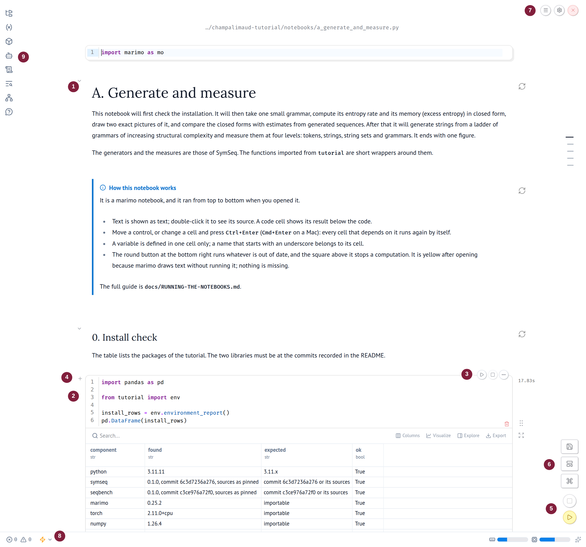

# Running the notebooks (marimo, for people who know Jupyter)

The three notebooks of this tutorial are marimo notebooks. In the browser they look like Jupyter notebooks, but they run differently, and that is confusing the first time. This page says how to start them, what is on the screen, how cells run, and what to do when something does not behave as you expect. Every command, key and message below was checked against marimo 0.25.2, the version this repository installs.

## In one minute

Open a terminal in the folder of the repository and start one notebook:

```bash
uv run marimo edit notebooks/a_generate_and_measure.py   # notebook A
uv run marimo edit notebooks/b_behaviour.py              # notebook B
uv run marimo edit notebooks/c_networks.py               # notebook C
```

1. Your browser opens the notebook. If it does not, copy the address that the terminal prints (it looks like `http://localhost:2718?access_token=...`) into the browser, with the token.
2. The notebook runs from top to bottom by itself. An hourglass turns at the top left while it runs. This takes between a few seconds and about a minute, most of it the install check and the imports. When it is done, the round button at the bottom right is still yellow and each text cell has a small round-arrows sign at its right: marimo draws text without running it and counts those cells as not yet run. Nothing is missing. Press the yellow button once if you want the signs gone.
3. Read it as you would a Jupyter notebook: text, then code cells with their result below the code.
4. Move a slider, or change a line of code and press `Ctrl+Enter` (`Cmd+Enter` on a Mac). Every cell that depends on what you changed runs again by itself.
5. To stop, close the tab, go back to the terminal, press `Ctrl+C` and answer `y`.

If nothing works on your laptop, open the saved pages in a browser: `fallback/a_generate_and_measure/a_generate_and_measure.html`, `fallback/b_behaviour/b_behaviour.html` and `fallback/c_networks/c_networks.html`. They are copies of the notebooks with their results; nothing can be changed in them.

## The screen



1. **Text cell.** Text is shown as text. A cell that only builds text shows a faded line in place of its code, and a click on it shows the code. Double-click the text to see and edit its source (Markdown); "Show code" and "Hide code" in the `...` menu of the cell, or `Ctrl/Cmd+H`, switch the source on and off. The round-arrows sign at the right of a text cell means that marimo has drawn the text without running the cell.
2. **Code cell.** The code, and below it the result: the value of the last line of the cell, as in Jupyter. What a cell prints appears under the result.
3. **Buttons of a cell.** They appear when the mouse is over the cell: run this cell, stop, and `...` for the menu of the cell (hide code, move, delete and others). The time the cell took is written at its right.
4. **New cell.** The `+` at the left edge of a cell adds a cell above or below it.
5. **Run and stop.** The round button at the bottom right runs every cell that is out of date; it is yellow when there is one, and also right after opening, because of the text cells. The square above it stops a running computation.
6. **Save, app view, command palette.** The notebook saves itself one second after a change, so the save button is rarely needed. App view (`Ctrl/Cmd+.`) hides all code and shows only text, controls and results; press it again to come back. The command palette (`Ctrl/Cmd+K`) finds every command by name.
7. **Menu, settings, shutdown.** The menu at the top right holds export, restart of the kernel and the list of keyboard shortcuts. The red cross stops the server; `Ctrl+C` in the terminal does the same.
8. **Runtime reactivity.** The lightning sign in the bottom bar says when cells run: on startup, when a cell changes, when a module changes. See "If you prefer to press run yourself" below.
9. **Side panels.** The icons at the left open, from top to bottom: files, variables, packages, chat, the outline of the notebook, documentation of the function under the cursor, and the graph of dependencies between cells.

## Three ways to run a notebook

| You want to | Command | What you get |
|---|---|---|
| Work through a notebook, read and change its code | `uv run marimo edit notebooks/NAME.py` | The editor described above. Changes are saved to the file. |
| Use or show a notebook without its code | `uv run marimo run notebooks/NAME.py` | The app: text, controls, tables and figures. Nothing can be edited. Add `--include-code` to let viewers open the code. |
| Run everything once, without a browser | `uv run python notebooks/NAME.py` | A plain Python run of all cells with every control at its default value. It prints nothing when all is well; an error stops it. |

`uv run` makes the command use the environment of this repository. If you activated that environment yourself (`source .venv/bin/activate`), leave `uv run` out.

Useful options of `edit` and `run`:

- `--port 2800` chooses the port. Without it marimo uses 2718, or the next free port when 2718 is busy, so two notebooks can be open at once, each started in its own terminal. A port you name yourself must be free.
- `--headless` does not open a browser; the terminal prints the address. Use it on a remote machine: start with `--headless --port 2718`, forward the port (`ssh -L 2718:localhost:2718 user@machine`), and open the printed address on your laptop.
- `--no-token` leaves the access token out of the address (for `edit`; `run` has none by default). Only on your own laptop.
- `--watch` reloads the notebook when its file is changed in another editor.

## How marimo runs cells, and why it feels different

| | Jupyter | marimo |
|---|---|---|
| What runs when you run a cell | That cell | That cell and every cell that uses a variable it defines |
| Order of execution | The order in which you pressed run | The order given by which cell needs which variable; the position of a cell on the page does not matter |
| Hidden state | Possible: delete a cell and its variables live on | Not possible: delete a cell and its variables are gone, and the cells that used them say so |
| The same variable in two cells | Allowed | Not allowed: a variable is defined in one cell only |
| Temporary variables | Any name | A name that starts with an underscore (`_tmp`) belongs to its cell alone and may be reused in other cells |
| File | `.ipynb` (JSON, with outputs) | `.py` (plain Python, without outputs) |
| Magics (`%time`, `!ls`) | Yes | No. Use Python (`time.perf_counter`, `subprocess.run`) |

What follows in practice:

- **There is no "run all" to remember.** The notebook has run when it opens, and after any change the cells that depend on it are up to date again.
- **A control is a variable.** A slider, switch or dropdown is created in one cell (`mo.ui.slider(...)`) and read in others (`slider.value`). Moving it runs the cells that read it.
- **A slow cell runs again when something it depends on changes.** This is why notebooks B and C have the switch "load saved results" at the top. While it is on, the slow computations are replaced by saved results and every control answers at once. Turn it off only when you want to compute or train yourself.
- **You cannot overwrite a variable in a later cell.** To change a table, change it in the cell that creates it, or give the new version a new name.
- **A cell that fails stops the cells that need it.** They show "An ancestor raised an exception" and the name of the failing cell. Fix that cell and the rest follows.

### If you prefer to press run yourself

Click the lightning sign in the bottom bar. "On cell change" set to lazy makes marimo mark dependent cells as out of date without running them; the yellow button at the bottom right (`Ctrl/Cmd+Shift+R`) then runs them when you choose. "On startup" is fixed for these notebooks: this repository asks marimo to run a notebook when it is opened (`[tool.marimo.runtime]` in `pyproject.toml`). Without that line marimo 0.25 opens a notebook with nothing run, and you would have to press the yellow button first.

## Keys worth knowing

| Key | What it does |
|---|---|
| `Ctrl/Cmd+Enter` | Run the cell |
| `Shift+Enter` | Run the cell and go to the next one |
| `Ctrl/Cmd+Shift+R` | Run all cells that are out of date |
| `Ctrl/Cmd+I` | Stop the running computation |
| `Ctrl/Cmd+H` | Hide or show the code of the cell |
| `Ctrl/Cmd+.` | App view on and off |
| `Ctrl/Cmd+Shift+O`, `Ctrl/Cmd+Shift+P` | New cell above, new cell below |
| `Shift+Backspace` | Delete the cell |
| `F12` | Go to the definition of the name under the cursor |
| `Ctrl/Cmd+K` | Command palette |
| `Ctrl/Cmd+Shift+H` | The full list of keyboard shortcuts |
| `Esc` | Command mode: arrows move between cells, `a` and `b` add a cell above or below, `Enter` edits |

## The three notebooks of this tutorial

Notebook A shows the install check as a table. Notebooks B and C repeat the check silently and stop with a message if it fails; the details are then in notebook A, `README.md` and `OFFLINE.md`.

| Notebook | Controls | What takes time |
|---|---|---|
| A, `a_generate_and_measure.py` | For the worked example: the probability p(A → B), the sequence length, a seed. For the ladder of grammars: alphabet size, number of states, contexts, fillers, depth, strings per grammar | Every change is recomputed in seconds. Larger values of "strings per grammar" and "sequence length" take longer. |
| B, `b_behaviour.py` | Switch "load saved results" (on), dropdown "dataset", slider "string" to browse the strings, a text area and a path box for a sequence of your own | With the switch off, the measures of the chosen dataset and of its two surrogates are computed. The largest dataset is the slowest; a spinner shows while it runs. |
| C, `c_networks.py` | Switch "load saved results" (on), dropdown "level" (the complexity of the grammar), choice "training strings" (50, 200 or 800) | With the switch on, changing a control only redraws one grammar and reads another saved run. With the switch off, two networks are trained on the first grammar of the chosen level with the chosen number of strings: one to two minutes, depending on the laptop. A progress bar counts the measurements. They are trained again whenever the level or the number of strings is changed. |

Notebooks A and B end in one figure. Notebook C has two, one for each of its parts, and ends in the second. The helper code is in the package `tutorial/`, and the notebooks call it, so the cells stay short. To read a function, put the cursor on its name and press `F12`, or open the file named in the import (for example `tutorial/measures.py`).

To use your own data in notebook B, paste a sequence into the text area, one string per line, with the symbols separated by spaces or commas (a line without separators is read one character per symbol). Or give the path of a CSV file with the columns `string` and `symbol`, and optionally `duration`. It needs at least 100 symbols and may have at most 30 000. The sequence stays on your laptop.

## Changing things

- **Change a cell.** Click into its code, edit, press `Ctrl/Cmd+Enter`. The cells that depend on it follow.
- **Change a text cell.** Double-click the text.
- **Add a cell.** Use the `+` at the left edge of a cell. Remember that a variable is defined in one cell only.
- **Change the helper code.** Edit the file in `tutorial/` with any editor, then restart the kernel from the menu at the top right. Or set "On module change" to autorun (lightning sign in the bottom bar): the notebook then picks up the change by itself.
- **Start again from the original.** The notebooks are plain files under git: `git checkout notebooks/NAME.py` restores one.
- **Do not edit a notebook file in another editor while it is open in marimo**, unless you started marimo with `--watch`. marimo saves its own version over yours.
- marimo keeps a folder `__marimo__` beside the notebooks for its own records. Git ignores it; it can be deleted at any time.

## If you would rather have Jupyter

A marimo notebook can be exported. The export to Jupyter needs one more package, which `--with` fetches for this one command (it needs a network connection the first time):

```bash
uv run --with nbformat python -m marimo export ipynb notebooks/a_generate_and_measure.py -o a_generate_and_measure.ipynb --sort top-down
uv run marimo export html notebooks/a_generate_and_measure.py -o a_generate_and_measure.html
uv run marimo export script notebooks/a_generate_and_measure.py -o a_flat_script.py
```

The first writes a Jupyter notebook without outputs (add `--include-outputs` to run it and keep them). The second writes a page with the results, like those in `fallback/`. The third writes one flat Python script. The Jupyter copy is for reading: its cells still call marimo, and its controls do not react. The tutorial itself is run from the marimo files.

## When something goes wrong

| What you see | What it means and what to do |
|---|---|
| The browser does not open | Copy the address from the terminal, with `?access_token=...`, into the browser. |
| The page asks for an access token | You opened the address without the token. Copy the full address from the terminal. |
| The address has another port than you expected | The port was busy, usually because an earlier notebook is still running in another terminal, and marimo took the next one. Use the address the terminal prints, and stop the old server with `Ctrl+C` in its terminal. |
| `address already in use` in the terminal | The port you gave with `--port` is taken. Leave `--port` out, or give another one. |
| The notebook is open but no code cell shows a result, and the button at the bottom right is yellow | Press that button (`Ctrl/Cmd+Shift+R`). This happens when a notebook is opened from outside this repository, where the setting described above does not apply. |
| "This cell redefines variables from other cells" | Two cells define the same variable. Rename one, or start the name with an underscore if it is temporary. |
| "An ancestor raised an exception" | A cell this one depends on failed. The message names it; fix that one. |
| "The install check failed" in notebook B or C | The environment is incomplete. Open notebook A to see which package, run `uv sync` again, or follow `OFFLINE.md`. |
| Everything runs again when you touch a slider | That is the design. If it is slow in notebook B or C, check that "load saved results" is on. |
| A computation does not end | Press the square button at the bottom right (`Ctrl/Cmd+I`). If the page no longer reacts, press `Ctrl+C` in the terminal and start again; your edits are saved. |
| "Not connected to a runtime" at the top of the page | The server was stopped or was not ready yet. Click "Click to connect", or start the notebook again from the terminal. |
| A figure does not change after you edited a file in `tutorial/` | The notebook still holds the old code. Restart the kernel from the menu at the top right. |
| `uv: command not found` | uv is not installed or not on the path. See "Install" in `README.md`. |

## To learn more

marimo ships interactive tutorials that open like any notebook:

```bash
uv run marimo tutorial intro               # the basics
uv run marimo tutorial for-jupyter-users   # the differences from Jupyter, hands-on
uv run marimo tutorial dataflow            # how cells depend on each other
uv run marimo tutorial ui                  # sliders, dropdowns and other controls
```

The documentation is at <https://docs.marimo.io>.
